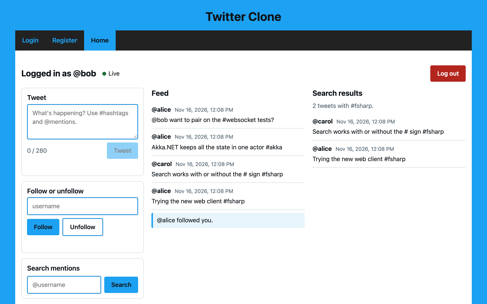
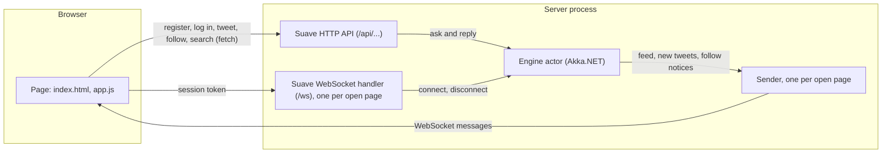

# Twitter Clone, Part II: web interface

A web interface for a Twitter-like engine, written in F#. A [Suave](https://suave.io/) web server serves one page, a JSON API and a WebSocket feed, and one [Akka.NET](https://getakka.net/) actor holds all of the data. Users register, log in, tweet with `#hashtags` and `@mentions`, follow and unfollow each other, and search by hashtag or mention. New tweets from the people they follow, and new followers, appear on the page as they happen.

This is Part II of Project 4 for COP 5615 Distributed Operating System Principles at the University of Florida (Fall 2021, Dr. Alin Dobra). It was updated in 2026. Part I, the engine and a load simulator that talk over Akka.Remote, is in [twitter-clone](https://github.com/michaelperez023/twitter-clone).

Written by [Michael Perez](https://github.com/michaelperez023) and [Blas Kojusner](https://github.com/bkojusner).



## What it does

- **Accounts.** A username is 1 to 15 characters: the letters A to Z (either case), digits and underscores. Usernames are case-sensitive. A password is 1 to 128 characters, and is stored as a salted PBKDF2-HMAC-SHA256 hash with 600,000 iterations.
- **Sessions.** Logging in returns a random session token. Tweeting, following, unfollowing and logging out need it in an `Authorization: Bearer` header, and the server takes the user from the token, never from the request body. Logging out ends the session and closes the live feeds opened with it. The page also logs out when it is closed or reloaded.
- **Tweets.** A tweet is 1 to 280 characters. Every hashtag and mention in it is indexed (hashtags regardless of case), and a tweet that mentions an unregistered user is refused. Hashtags are made of the same characters as usernames, and punctuation right after a hashtag or mention is left out; one that runs into another letter, such as `#café`, does not count. A tweet goes into the feed of its author and of each of the author's followers, and shows up right away on the pages they have open.
- **Following.** Users follow and unfollow each other. A user who gets a new follower sees a notice on their open pages.
- **Searches.** Anyone can get the 10 most recent tweets that mention a user or carry a hashtag.
- **Live feed.** When the page opens its WebSocket, the server sends the 10 most recent tweets of the user's feed and then each new one as it is posted. A user can have several pages open at once. If the connection drops, the page says so and reconnects by itself.
- **Limits.** Each feed, hashtag and user's mentions keep their 100 most recent tweets.

Everything is kept in memory, so restarting the server clears all users, sessions and tweets. Sessions do not expire: a session lasts until its page logs out or the server restarts. There is no TLS: passwords and session tokens cross the network in plain text unless the server sits behind an HTTPS proxy, so don't use a password you use anywhere else.

## Architecture



- **Engine** ([`Engine.fs`](src/TwitterClone/Engine.fs)) is one Akka.NET actor that owns all of the state: users and their password hashes, followers, feeds, the hashtag and mention indexes, sessions and open WebSocket connections. It handles one request at a time, so requests that arrive together cannot interfere. The rules themselves are pure functions in [`Domain.fs`](src/TwitterClone/Domain.fs), which the tests call directly. A request that breaks a rule, or fails unexpectedly, gets an error reply; it never makes the actor fail, so Akka.NET never restarts it with empty state.
- **HTTP API** ([`Server.fs`](src/TwitterClone/Server.fs)) reads the JSON body, asks the engine and turns the reply into JSON with an HTTP status code. Hashing is slow on purpose, so it happens in the request handler, not in the engine: registering hashes the password and then asks the engine to store it, and logging in asks the engine for the stored hash, checks the password, and then asks the engine to open a session.
- **WebSocket handler.** The page connects to `/ws` and sends its session token. The handler registers the connection with the engine, which sends the feed and from then on new tweets and follow notices. Each connection has its own sender (an F# `MailboxProcessor`) that sends its messages in order; a send that fails ends that connection and no other. The sender pings the page every 30 seconds, which browsers answer on their own. If nothing at all has come back for more than 75 seconds when a ping is due, it ends the connection instead, so a page that has gone away is noticed within about 90 seconds. The pings also keep a proxy from closing a quiet feed. However a connection ends (a close frame, a failed read or send, or silence), the handler unregisters it.
- **Page** ([`wwwroot`](src/TwitterClone/wwwroot)) is plain HTML, CSS and JavaScript with no external libraries. It puts all text from users into the page as text, never as HTML.
- [`Program.fs`](src/TwitterClone/Program.fs) reads the command line, starts the server and stops it on Ctrl+C. Stopping closes the open feeds first and gives the pages a moment to answer, so they see a clean close.

## JSON API

| Request | Body | Success | Errors |
| --- | --- | --- | --- |
| `POST /api/register` | `{"username", "password"}` | 201 | 400 invalid username or password, 409 username taken |
| `POST /api/login` | `{"username", "password"}` | 200, with `username` and `token` | 400 invalid username or password, 401 wrong username or password |
| `POST /api/logout` | none | 200 | 401 |
| `POST /api/follow` | `{"username"}` | 200 | 400 yourself or invalid username, 401, 404 unknown user, 409 already following |
| `POST /api/unfollow` | `{"username"}` | 200 | 400 yourself or invalid username, 401, 404 unknown user, 409 not following |
| `POST /api/tweet` | `{"text"}` | 201, with `tweet` | 400 empty, longer than 280 characters, or mentions an unregistered user; 401 |
| `GET /api/search/mentions/{username}` | none | 200, with `tweets` | 400 empty search |
| `GET /api/search/hashtags/{hashtag}` | none | 200, with `tweets` | 400 empty search |

- API replies are JSON objects with `ok` (`true` or `false`) and a `message` for the user, plus the fields in the table. A body that is not a JSON object with the listed string fields gets 400, and a request with the wrong method gets 405. A body over 64 KB is refused by Suave itself with a 413 and a short non-JSON reply ("Payload too large").
- Logout, follow, unfollow and tweet need the token from `/api/login` in an `Authorization: Bearer <token>` header; the WebSocket takes it as its first message.
- A search term may start with `@` or `#` (URL-encoded as `%40` and `%23`). The search returns up to 10 tweets, newest first; no tweets is a normal result.
- A tweet looks like `{"id": 1, "author": "alice", "text": "Hello #fsharp", "time": "2026-11-16T15:42:08.500Z"}`, with the time in UTC.

WebSocket messages on `/ws`:

| From | Message |
| --- | --- |
| Page, first | `{"token": "..."}` |
| Server, once | `{"type": "feed", "tweets": [...]}`: the 10 most recent tweets in the user's feed, newest first |
| Server | `{"type": "tweet", "tweet": {...}}`: a new tweet in the user's feed |
| Server | `{"type": "follow", "from": "alice"}`: alice followed the user |
| Server | `{"type": "error", "message": "..."}`, and then the server closes the connection: with code 1008 if the token is not valid, the first message was not a token, or no token arrived within 10 seconds, and 1011 if the feed could not be opened |

The server also closes a feed with code 1000 when its session logs out and 1001 when the server stops. The page logs out on 1008 and reconnects after any other close.

With curl:

```sh
curl -H "Content-Type: application/json" -d '{"username": "alice", "password": "not a real password"}' http://127.0.0.1:8080/api/register
curl -H "Content-Type: application/json" -d '{"username": "alice", "password": "not a real password"}' http://127.0.0.1:8080/api/login
curl -H "Content-Type: application/json" -H "Authorization: Bearer <token from the login reply>" -d '{"text": "Hello #fsharp"}' http://127.0.0.1:8080/api/tweet
curl http://127.0.0.1:8080/api/search/hashtags/fsharp
```

## Running it

You need the [.NET 10 SDK](https://dotnet.microsoft.com/download/dotnet/10.0). The first build downloads Akka.FSharp 1.5.74 and Suave 3.7.2 from nuget.org.

```sh
dotnet run --project src/TwitterClone
dotnet run --project src/TwitterClone -- --port 9000
```

The server prints the URL to open in a browser (`http://127.0.0.1:8080/` by default). `--host 0.0.0.0` listens on all network interfaces instead of only this computer; the server still prints the `127.0.0.1` URL for this computer, and other devices use this computer's IP address. `--help` prints the usage. Stop the server with Ctrl+C.

To try it as two users, register and log in as one user in a normal browser window and as another in a private window, side by side. Each tab keeps its own session, so two tabs work as well.

## Tests

```sh
dotnet test
```

- [`DomainTests.fs`](tests/TwitterClone.Tests/DomainTests.fs) tests the pure functions: the username and password rules, password hashing, the follow and unfollow rules, tweet parsing and length, delivery to followers only, and the 100-tweet and 10-result limits.
- [`ServerTests.fs`](tests/TwitterClone.Tests/ServerTests.fs) starts the real server (Suave and an actor system) on a free port and uses it with `HttpClient` and `ClientWebSocket`: registering, logging in and out, requests without a valid token, malformed JSON, requests that arrive together, live follow notices and tweets, unfollowing, following a user who is offline, closed and dropped connections, tweets with `& $ < > "` in them, searches, and serving the page. It also checks the defaults (600,000 iterations, and the page found next to the program) and the URL the server prints, and drives a connection's sender with a fake socket: a failed send, pings and silence, and a close that is not answered.

The tests use xUnit.net v3 on Microsoft.Testing.Platform, which [`global.json`](global.json) selects for `dotnet test`. They hash passwords with 1,000 iterations instead of 600,000, and take a few seconds.

## Continuous integration

[`.github/workflows/ci.yml`](.github/workflows/ci.yml) runs on GitHub Actions with .NET 10 on Ubuntu. It builds the solution in Release, with warnings treated as errors, checks the syntax of the page's script (and that it builds no HTML from strings), and runs the tests. Then it starts the built server, checks that it serves the page, registers a user, logs in, posts a tweet and finds it with a hashtag search using curl, and stops the server. The job fails if any of these steps fails or if the server does not exit cleanly.

## Credits

The WebSocket handler started from Suave's [WebSocket example](https://github.com/SuaveIO/suave/tree/master/examples/WebSocket).
